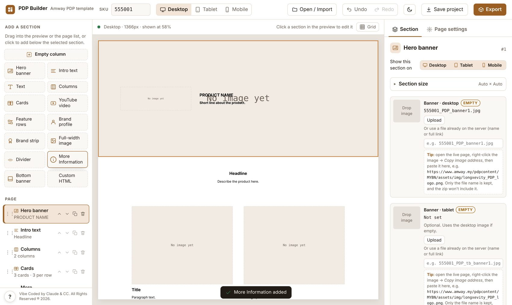

# PDP Builder

A drag-and-drop builder for **Amway Malaysia product detail pages (PDP)**. Add sections, fill in text and images, preview on desktop, tablet and mobile, then export a ready-to-upload `{SKU}_en.html` with its SKU-named images, in English, Bahasa Melayu and 中文.

It is a single `index.html` file: no install, no build step, no server. Open it in a browser and start.



📘 **[How to use guide (PDF)](PDP-Builder-Guide.pdf)**

---

## Features

- **Sections** – Hero banner, Intro text, Text, Columns, Cards, Feature rows, Brand profile, Brand strip, Full-width image, YouTube video, Divider, More Information, Bottom banner, Custom HTML, and an Empty column to build anything.
- **Elements** – Headline, Title, Paragraph (bold, italic, lists, links), Icon, Icon row, Image, Logo, Button and Divider, each with its own alignment, size, colour, spacing and show/hide per device.
- **Layout** – unlimited wrapping columns, cards (image on top or left), backgrounds (colour, gradient, image), corner radius per corner, padding, gaps, content position grid and alignment across the line.
- **Responsive** – preview Desktop (>1200px), Tablet (769–1200px) and Mobile (≤768px); hide anything per device; per-device element spacing and width; page min/max width.
- **Languages** – translate texts and swap images per language; exports `{SKU}_en.html`, `{SKU}_bm.html`, `{SKU}_zh.html`.
- **Images** – automatic SKU-based names (`{SKU}_PDP_banner1.jpg`, `_img1`, `_icon1`, `_logo` …), reuse files already on the server, optional resize and compression on export.
- **Import** – open a live PDP page to edit it; pages from other templates keep their own CSS, and Custom HTML can be converted into editable sections.
- **Safety nets** – undo/redo, autosave with restore, save/open projects as `.html`, pre-export checks and a server check that every referenced image exists.
- **Keyboard shortcuts** – press `?` in the builder for the full list.

## Getting started

1. Open `index.html` in Chrome, Edge, Safari or Firefox (or the GitHub Pages link below).
2. Type the product **SKU** in the top bar.
3. Add sections from **Add a section**, click anything in the preview to edit it.
4. Fill in **Page settings** (title, description, keywords, languages).
5. Press **Export** → **Save .zip**.

## Uploading a page

The zip contains:

```
{SKU}_en.html
{SKU}_bm.html        (if Bahasa Melayu is on)
{SKU}_zh.html        (if 中文 is on)
assets/img/…         (new uploads only)
```

Upload the files to `pdpcontent/MYBN/`, keeping the `assets/img/` folder. The pages use the existing `assets/css/artistry.css`, `assets/js/jquery-3.4.1.min.js` and `assets/js/frameHeight.js` already on the server, so those are not included. Images that already exist on the server are referenced, not re-uploaded.

## Hosting on GitHub Pages

1. Put these files in the root of the repository:
   ```
   index.html
   PDP-Builder-Guide.pdf
   screenshot.jpg
   README.md
   ```
2. **Settings → Pages → Build and deployment**: Source *Deploy from a branch*, branch `main`, folder `/ (root)`.
3. Open `https://<your-username>.github.io/<repo-name>/`.

Opening the builder from GitHub Pages (rather than a local file or inside claude.ai) lets the preview load live images from `amway.my` and lets the export run the server image check.

## Good to know

- Work is autosaved in the browser you use. To move it to another computer, use **Save project** and **Open / Import**.
- The preview reloads for about a second after each change.
- HEIC images (iPhone photos) are not supported by browsers; convert them to JPG first.
- External libraries load from cdnjs (JSZip for the zip export). Bootstrap 3.3.7 and `artistry.css` are bundled inside the builder for the preview only.

---

Vibe Coded by Claude & CC. All Rights Reserved ® 2026.
